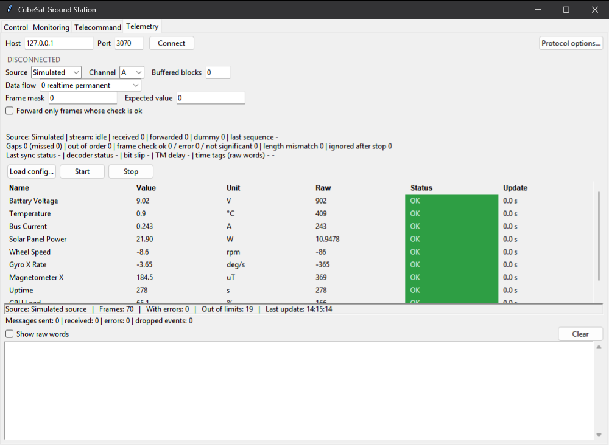

# CubeSat Ground Station

A Tkinter ground station for a CubeSat. Four tabs (Control, Monitoring, Telecommand, Telemetry) talk
COP-1 and CORTEX over TCP. A built-in set of mock servers lets you try everything offline.
Python standard library only; pytest is needed only to run the tests.



> **Status.** The protocol code was written from the COP-1 and CORTEX interface documents and has been
> tested against the built-in mock servers, which were written from the same reading. It has **not**
> been verified against the real servers. The open questions are listed under
> [Assumptions](#assumptions-that-are-not-confirmed), and the options that change them are in the
> "Protocol options..." dialog.

## Features

- **Control**: stage values for configuration parameters 0 to 39 and send only the staged ones. Each
  parameter shows the acknowledgement, a rejection or "no response".
- **Monitoring**: request the monitoring report (optionally on a timer) and show the configuration table,
  the status table, the error flags, the COP-1 version and the telemetry port.
- **Telecommand**: build one request at a time (BD segment, AD segment, CLTU, Transfer Frame, directive,
  NOP, output flow subscription), send it, and follow its replies in a requests table.
- **Telemetry**: a table built from a JSON parameter file, fed by a simulated source or by CORTEX
  telemetry over the network. Values are decoded with limits and a per-parameter status.
- **A silent server is visible**: a request that gets no reply is shown as "no response (timeout)",
  "stale" or "no frame yet" after a configurable reply timeout, and a late reply still replaces that text.
- **Defensive networking**: stream resynchronisation, a message size cap, bounded queues, strict input
  parsing, and fuzz and hostile-server tests.
- **Diagnostics**: `selfcheck` to verify an installation, or to send one read-only request to a real
  server, and a crash log that records every unhandled exception.

## Requirements

- Python 3.10 or newer. 3.10 is the version this was written and tested with; older versions were
  not tried and are refused with a plain message.
- tkinter (the Tk toolkit). The python.org Windows installer includes it ("tcl/tk and IDLE" must be
  ticked). On Linux install the `python3-tk` package.
- pytest, only to run the tests. No other packages are needed to run the program.

## Quick start

On Windows the three launchers in this folder find Python for you (`python`, then `py -3`):

```
run_app.bat                      the application (extra options are passed on)
run_mock.bat                     the four mock servers for an offline demo
run_tests.bat                    the test suite (extra pytest options are passed on)
```

On any platform, from this folder:

```
python -m groundstation          the application
python -m groundstation.mockserver_cli
python -m groundstation.selfcheck
python -m pytest
```

Application options: `--config PATH`, `--rate HZ`, `--corrupt P`, `--host HOST` (default 127.0.0.1) and
`--port-offset N` (added to the default ports Control 3101, Monitoring 3100, Telecommand 3120,
Telemetry 3070).

## Offline demo with the mock servers

1. `run_mock.bat` (leave it running). It prints `READY <service> <host>:<port>` four times and `ALL READY`.
2. `run_app.bat --config samples/sample_config_10.json` in a second window.
3. In each tab press Connect. Telemetry: choose Source "Network", then press Start.

### What a successful mock demo does and does not prove

It proves that the program runs on the machine it was started on, that the four tabs build and parse
messages the way we read the interface documents, and that our request builders and reply parsers agree
with each other. It does **not** prove that our reading matches the real servers: the mock server was
written from the same reading (it is a test double). A passing demo can hide a wrong checksum mode,
wrong flow IDs, wrong byte numbering or a wrong time epoch, because the mock shares our assumptions.

## Connecting to a real server

1. Check the machine. `python -m groundstation.selfcheck` must end with `VERDICT: PASS`.
   It takes a few seconds and contacts nothing outside this computer.
2. Check the server is reachable, read only.
   `python -m groundstation.selfcheck --host <server address> [--port-offset N]`
   sends ONE monitoring request and prints the exact words sent and received, or
   "no reply within 5 s". It never sends a control, telecommand or telemetry request.
3. Start the application: `run_app.bat --host <server address> [--port-offset N]`.
4. Connect the tabs in this order: Monitoring (read only), Control, Telecommand, Telemetry.
5. If a tab shows no reply, open "Protocol options..." and look at the table below.
   Every silent request is shown, never hidden: after the reply timeout (5 s by default, set in
   Protocol options as "Reply timeout (s)", 0.5 to 300) a Control or Telecommand row reads
   "no response (timeout)", the Monitoring tab reads "stale (no report within N s)", and the Telemetry status
   block reads "no frame yet, N s since the request". A reply that arrives later still replaces that text.
   The log gets one line for each timeout, with the same hint as for a rejection.
6. If a tab shows "rejected (-1)" the server answered with its negative message.
7. Errors that escape the program are printed and appended to `groundstation_errors.log` in the folder
   you started it from. Include that file when you report a problem.

| What you see | Most likely cause | What to change in "Protocol options..." |
|---|---|---|
| Timeout or "rejected (-1)" on every tab | wrong flow IDs | the four flow ID fields (defaults: Control 1, the others 0) |
| Timeout or "rejected (-1)" only for telecommand data (BD, AD, CLTU, Transfer Frame) | wrong checksum mode | Checksum mode: whole_packet, excluding_postamble or payload_only |
| Segment length refused locally or by the server | FEC bytes inside the frame or not | "FEC in frame" |
| Telemetry frames arrive but every frame check reads "error" or "not significant" | byte numbering of the check word | "Byte numbering" |
| Replies arrive, but after the timeout | a slow server | "Reply timeout (s)" |
| "no frame yet" after Start, no refusal | wrong telemetry flow ID, channel or data flow | the Telemetry flow ID, and the Channel and Data flow boxes on the tab |

## Assumptions that are not confirmed

All of these are working assumptions made from the interface documents. None was checked against a real server.

| Assumption | Our default | Effect if it is wrong |
|---|---|---|
| Checksum mode (which words the checksum covers) | whole_packet | the server rejects or ignores telecommand data requests; other requests do not carry a checksum |
| Byte numbering of the CORTEX frame check word | byte 0 is the most significant byte | only the interpretation of the frame check (ok, error, not significant) changes; table values do not |
| Flow IDs | Control 1, Monitoring 0, Telecommand 0, Telemetry 0 | requests are ignored or rejected, so replies are missing |
| FEC bytes inside the frame | no | only the largest segment the program allows (1019 bytes, or 1017 with FEC) |
| Time tag epoch | unknown | time tags are shown as raw 32-bit words and are never converted to a date |
| Which replies belong to which request | the Negative reply and the unrecognised reply carry no tag, so they are attributed to the OLDEST outstanding request (an unverified first-in-first-out guess) | a failure can be shown against the wrong row if the server answers out of order |
| Which Telecommand operations get an immediate reply | all of them (the Accept/Reject reply carries the operation code); this comes from the table layout and from our mock, not from the real server | an operation that is never answered would wrongly read "no response (timeout)" |
| Telemetry messages are told apart by size (20 bytes, 68 bytes or more) | yes, as read from the CORTEX interface document | an odd message on the telemetry connection can be classified as a frame or a dummy |
| The mock server | it is a test double written by us | see "What a successful mock demo does and does not prove" |

## Diagnostics

- `python -m groundstation.selfcheck`: installation check against built-in mock servers.
- `python -m groundstation.selfcheck --host H [--port-offset N] [--timeout S]`: one read-only monitoring request.
- `python -m groundstation.selfcheck --host H --probe`: that request once per checksum mode. The monitoring
  request has no checksum field, so the probe cannot tell the checksum modes apart; it says so in its
  output and says nothing about flow IDs.

## Tests

`run_tests.bat` or `python -m pytest`. The GUI tests use one shared hidden Tk window and need a display;
the network tests use 127.0.0.1 with OS-chosen ports. Run them with nothing else heavy on the machine.

## More documentation

`groundstation/README.md` describes the window, the reply timeout, the crash log, the command line and
the source layout in more detail.

## License

MIT, see `LICENSE`.
